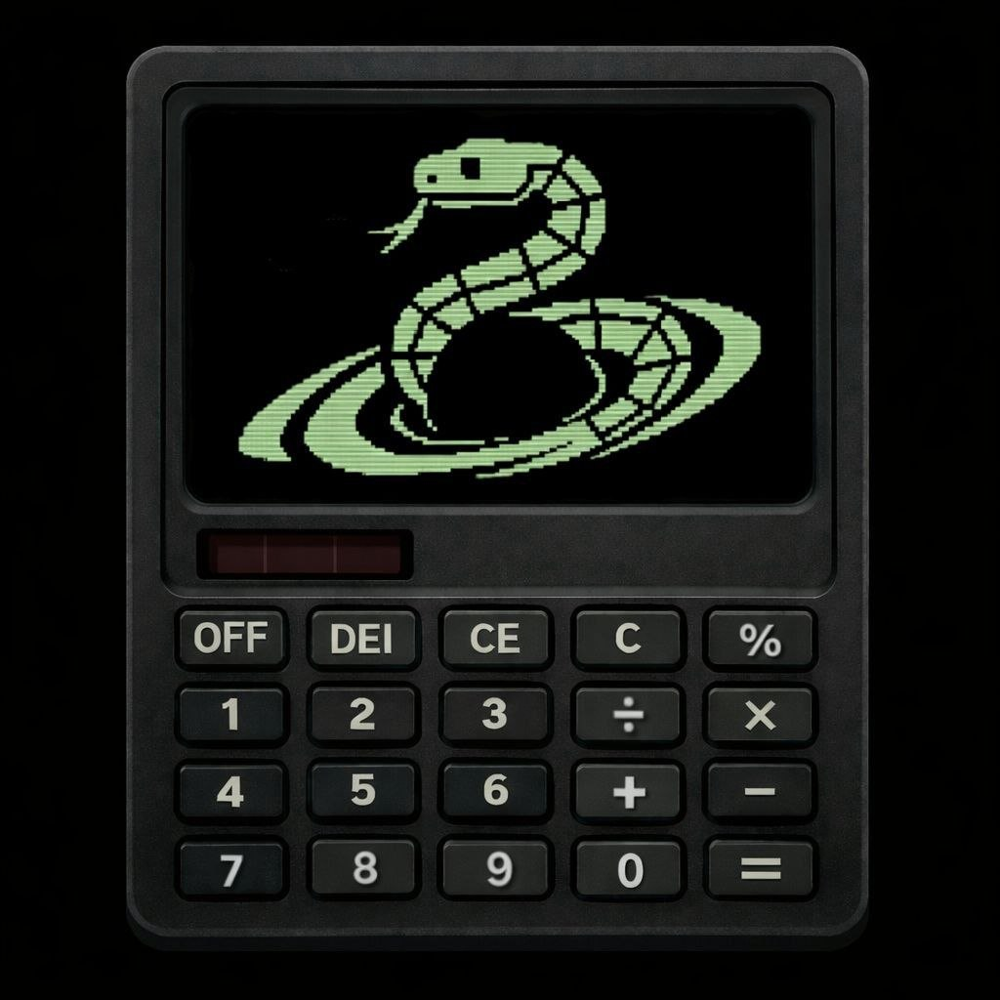
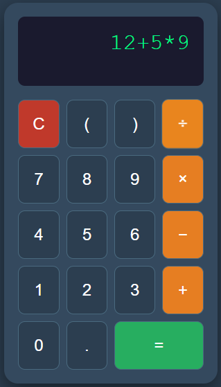

# Calculator v.4

> A compact browser calculator continuing the NESTIMS calculator series.

| Project Information | Details |
|---|---|
| Project ID | NS-015 |
| Direction | Infotech |
| Development Phase | Phase II |
| Version | Original |
| Platform | Browser / Web |
| Status | Completed |

> 

## 📖 Overview

A standalone HTML calculator with a graphical keypad and keyboard support. No server or installation is required.

## ✨ Features

- Basic arithmetic

- Decimal numbers and parentheses

- Keyboard input

- Expression evaluation and error messages

- Clear and reset controls

## 🛠 Technology Stack

- HTML
- CSS
- JavaScript

## 📦 Installation

- Download the HTML file: [more...](calculator.html)

- Open the downloaded file in a web browser.

## 📄 Documentation

- Russian documentation: [more...](Calc_v.4_RU.md)

- English documentation: [more...](Calc_v.4_EN.md)

## 📊 Project Status

A completed NESTIMS Phase II project. CI tests the JavaScript logic with a simulated document; visual browser behavior is not covered.

## 📷 Screenshots

© NESTIMS
